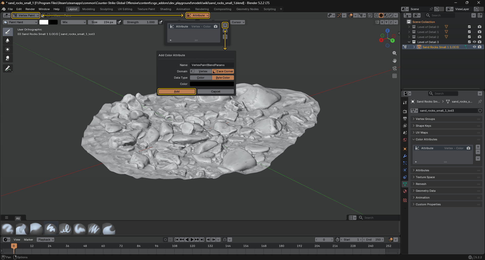
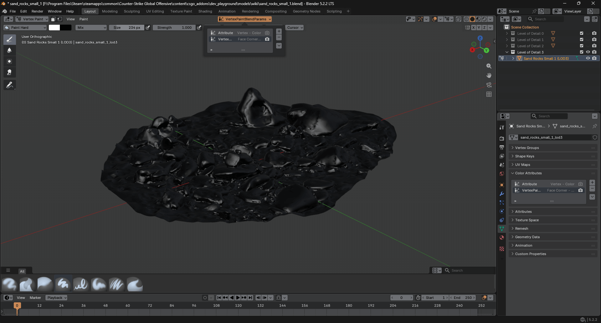
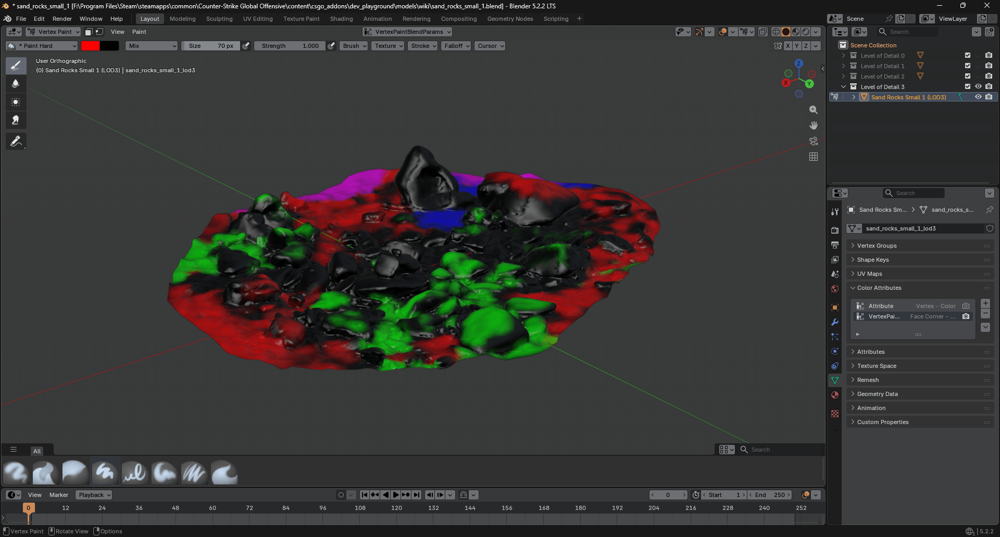
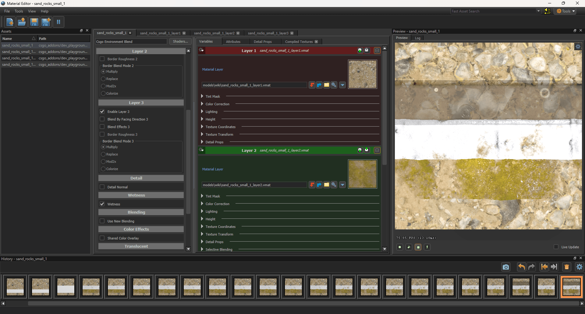
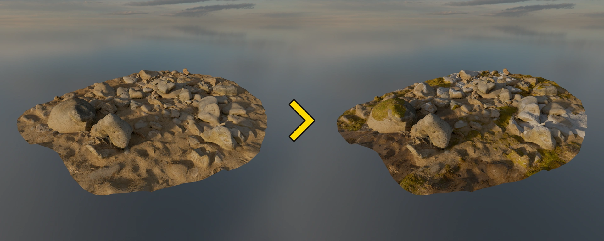

## Step 1. Creating a Color Attribute

- In Blender, switch to **Vertex Paint** mode.
- Click the Attribute dropdown in the top header.
- Click the plus button on the right.
- Set the following parameters in the pop-up window:
    - **Name:** `VertexPaintBlendParams`
    - **Domain:** Face Corner
    - **Data Type:** Byte Color
- Click Add.

## Step 2. Vertex Painting

In Blender, switch to **Vertex Paint** mode and paint your model according to the <Game name="cs2"/> shader requirements below.

### Csgo Environment Blend

| Vertex Сolor | HEX | Layer in shader | Notes |
| ------------ | --- | --------------- | ----- |
| Black | `#000000`	| Layer 1	|
| Red	| `#FF0000`	| Layer 2	|
| Green	| `#00FF00`	| Layer 3	|
| Blue	| `#0000FF`	| Wetness	| Apply over the black color (Layer 1) |
| Pink	| `#FF00FF`	| Wetness	| Apply over the red color (Layer 2) |
| Cyan	| `#00FFFF`	| Wetness	| Apply over the green color (Layer 3) |

### Csgo Simple 2way Blend

| Vertex Сolor | HEX | Layer in shader |
| ------------ | --- | --------------- |
| Black | `#000000` | Layer 1 |
| Red   | `#FF0000` | Layer 2 |

## Step 3. Result

