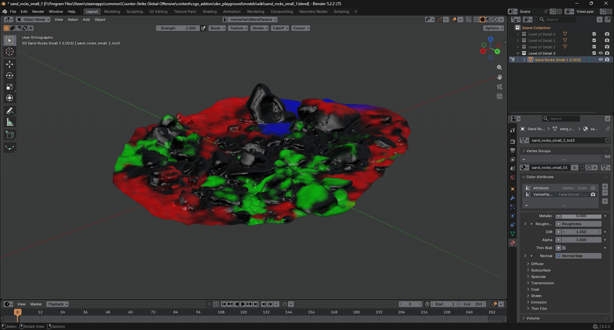
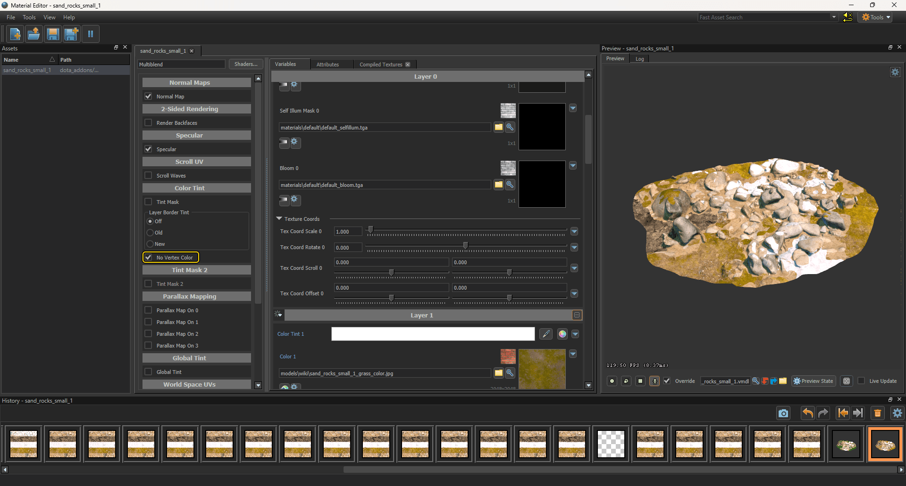
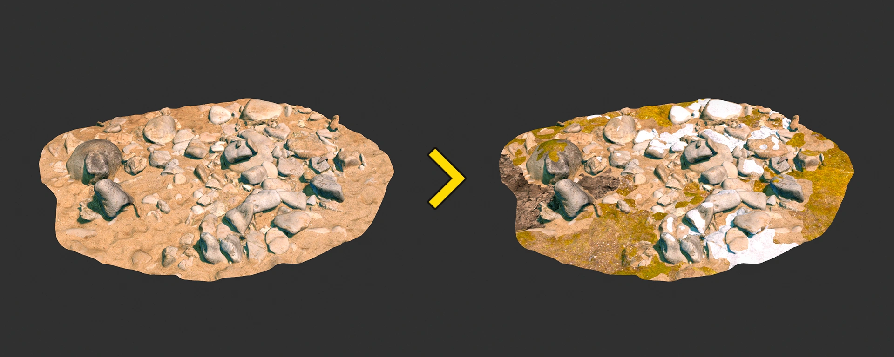

## Step 1. Creating a Color Attribute

- In Blender, switch to **Vertex Paint** mode.
- Click the Attribute dropdown in the top header.
- Click the plus button on the right.
- Set the following parameters in the pop-up window:
    - **Name:** `VertexPaintBlendParams`
    - **Domain:** Face Corner
    - **Data Type:** Byte Color
- Click Add.

## Step 2. Vertex Painting

In Blender, switch to **Vertex Paint** mode and paint your model according to the <Game name="dota2"/> shader requirements below.

### Multiblend

| Vertex Сolor | HEX | Layer in shader |
| ------------ | --- | --------------- |
| Black   | `#000000` | Layer 0
| Red     | `#FF0000` | Layer 1
| Green   | `#00FF00` | Layer 2
| Blue    | `#0000FF` | Layer 3

:::warning
For correct vertex blending behavior, make sure to check the "No Vertex Color" checkbox in the shader options.
:::

## Step 3. Result

