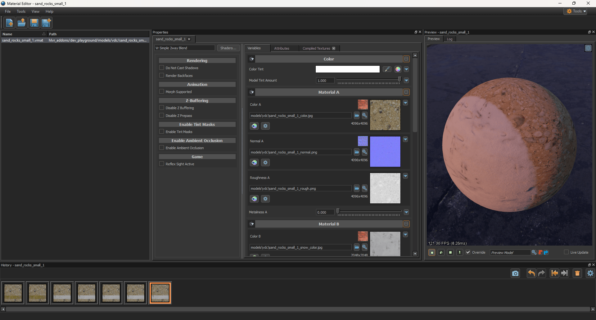
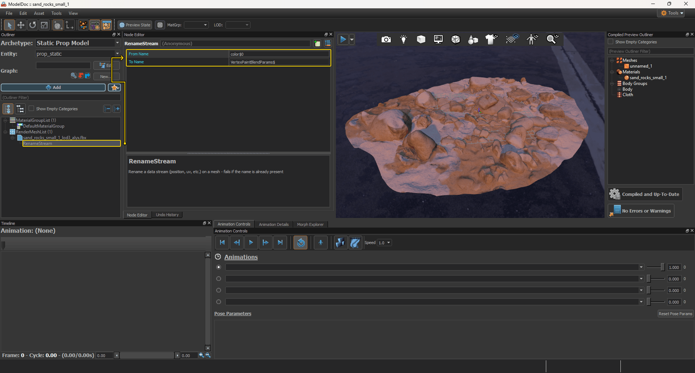

## Step 1. Creating a Color Attribute

- In Blender, switch to **Vertex Paint** mode.
- Click the Attribute dropdown in the top header.
- Click the plus button on the right.
- Set the following parameters in the pop-up window:
    - **Name:** `VertexPaintBlendParams`
    - **Domain:** Face Corner
    - **Data Type:** Byte Color
    :::info
    Although the <Game name="hla"/>  model compiler ignores custom attribute names, you can specify this specific name to ensure compatibility with other Source 2 games.
    :::
- Click Add.

## Step 2. Vertex Painting

In Blender, switch to **Vertex Paint** mode and paint your model according to the <Game name="hla"/> shader requirements below.

### Vr Simple 2way Blend

| Vertex Сolor | HEX | Layer in shader |
| ------------ | --- | --------------- |
| Black | `#000000` | Layer 1	|
| Red   | `#FF0000` | Layer 2	|

## Step 3. Renaming a data stream

Since the <Game name="hla"/> model compiler ignores custom FBX attribute names, you must rename the data stream for correct blending.

- Open your model via ModelDoc.
- Right-click on the render mesh.
- Find and select **Add RenameStream**.
- Click on **RenameStream** under the desired mesh and fill in the nodes as shown below:
    - **From Name:** `color$0`
    - **To Name:** `VertexPaintBlendParams$`
    :::info
    The number corresponds to the color index order in Blender's color attributes list. By default, this is `color$0`. However, if your object stores other attributes, this data stream will shift down the list, which means you'll need to enter `color$1` or a higher index to select the correct index.
    :::

## Step 4. Result

