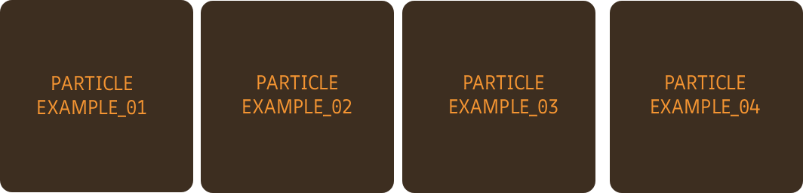
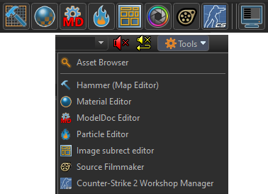
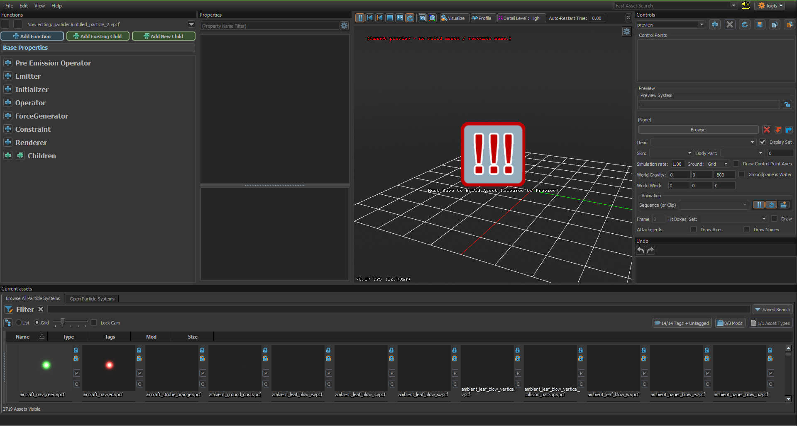
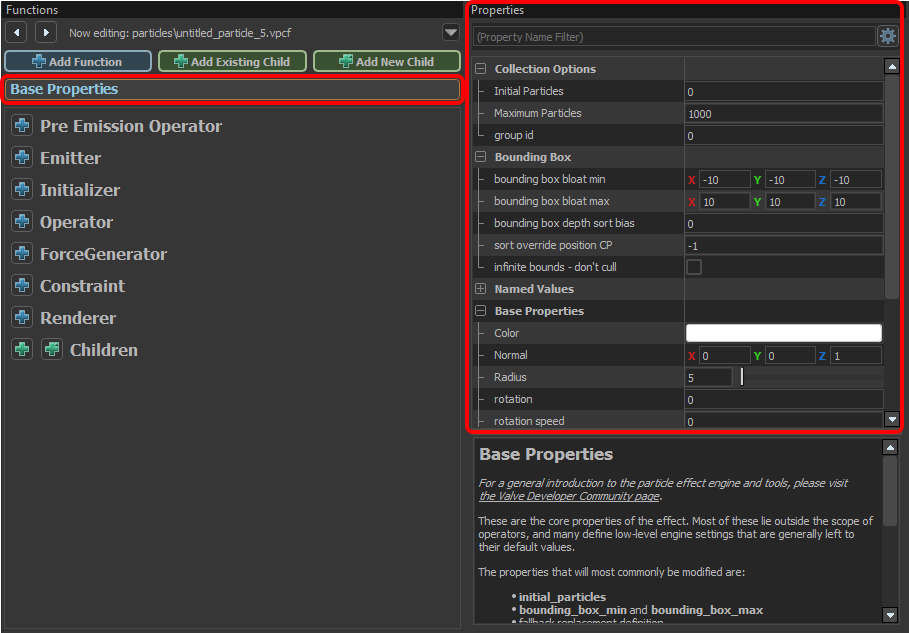
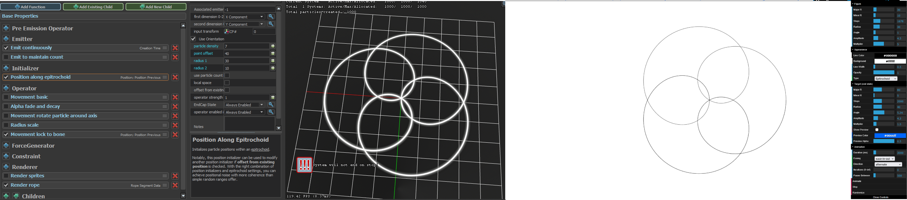
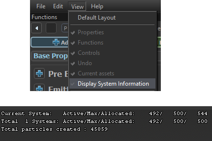

# Getting started
## Prerequisite
The particle editor is disabled in <Game name="cs2"/> by default, to enable it go to
`steamapps/common/Counter-Strike Global Offensive/game/bin/sdkenginetools.txt`, in `m_EngineTools` find the `m_Name = "pet"` section 
and comment out `csgo` from `m_ExcludeFromMods`.

## Use cases & examples
Particles serve integral part of the game assets & world.

particles are created to help create feedback to the player in combination with guns,utility, map hazards
or to help bring life and extra details to enviroments through story telling & player interactions.

few examples below should help establish, what most common uses of particle system

weapon impacts, molotov fire & smoke,snow,rain & ripples,sparks,petals,leaves,bits of breakable models,ambience effects (fireflies,)

:::todo
Find interesting particle systems within official & community maps & assets.
Add particle name, map & map creator (perhaps even workshop or particle to download hyperlink to the bottom or somewhere clarity 100 needed.)
:::

## Getting started
Particle editor can be opened by either asset browser toolbar or tools drop menu. using its icon 
*if particle editor is not present in either of the menus reffer to <a href="./Introduction#prerequisite" >prerequisite</a>*

## User Interface
Particle editor is composed by 7 tabs
1. Functions - internal logic that creates & manipulates the particle
2. Properties - windows responsible for setting the values,bools, properties of selected functions
3. Render view - preview of particle system, with debugging, and metric windows.
4. Controls - supportive window for setting up scene models, control points, manipulation of simulation speed in render view.
:::bug
simulation rate cannot be changed to lowered below 1 (realtime) anything lower will not work
:::
5. Histogram - action history
6. Asset browser - library of opened & all particle systems
Start by creating new file by navigating to the windows context menu or by shortcut `Ctrl+N` to view full UI options.

## Functions & Properties
:::todo
Find a way to show users without creating new particle function buttons options will not appear
:::
These two section works together and are essential to the creation of particles.

below function label are 2 buttons, they are usable if there are more than one particle system are opened and serves as next/previous button for easy navigation between multiple particles.
in middle is path&name to the particle and on the right side is a asset menu

Base properties are bounds or rather core of the currently opened particle system.
They are really helpful when multiple particle systems are introduced as child relations.

:::info
Base Property Lifetime of 1 () can change how some of the functions of system works, especially those which are timed without mentioning `in seconds`
> example could be Operator `Alpha Fade and decay` which has 4 values tied to the lifetime but take proportion of it. with default value they take half second, when value base property lifetime is set to 2 they take 0.5 which equal to 1s
:::
---
## Functions
###  Pre emission Operator
rarely used even by valve particle systems they help with manipulation of system before emitter start to create particles.
###  Emitter
Emitters creates/spawns renderers, their properties set either number,duration or rate to spawn they are limited by base properties maximum particles value.
- Continuous Emitter - Index,Duration (s),Start Time,Emission Rate, scale emission by parent count,emit particles for parent particle events,cp with SS data, limit per udpate
- Emit noise
- Emit to Maintrain Count
- Instantaneous Emitter
###  Initializer
their job is to take renderers created by emitters and put them to world space or position under various conditions.
- `Position along epitrochoid` this is really beautiful use of math.
Epitrochoid uses 2 radius values & point offset to paint beautiful circular patterns.
using this site we can create one by ourselves, without extensive trial & error due to density tweaking.
particle density just serves as speed for drawing, due to how complex some of the drawings can become.
multiplier in the website

`point offset = radius - 10` `Major R = Radius1` `Minor R = Radius 2`
###  Operator
Manipulates Renderers after their initializion, operators are only who can enable particles to be destroyed if whole system is not deleted by map logic or code.
###  Force Generator
changes how system behaves, usually taking from world, or adding on top of the systems functions
###  Constraint
limits the system in various aspects mostly in movemement or bounds.
###  Renderer
Actual visual part of the particle.
## Properties
is controlling and dictating variables of functions,
input values, float, vectors, colors,gradients, textures, states, booleans are set here for fine tunning.

Particullary Float & Vector can be adapted through various modifiers to achieve variable results

---
## Render viewer
if you have previously worked with any other S2 tool this is familiar viewport with adapted controls.
start with enabling displaying system information, this serves as somewhat perfomance monitor.
